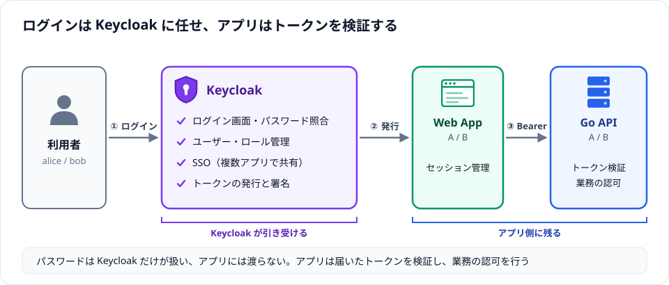
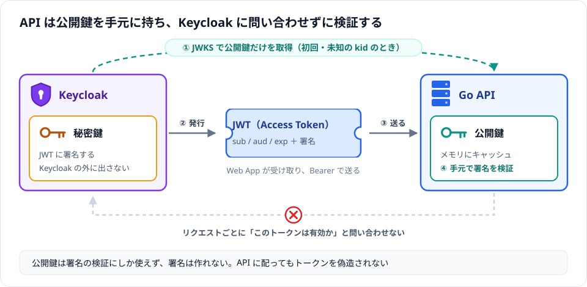
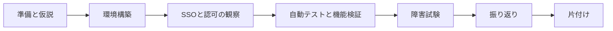

# Keycloak × Go：共有認証基盤とSSOを検証するハンズオン

## Overview

- **目的**：複数WebアプリでKeycloakを共有すると、何が共通化され、どこに依存と業務責任が残るかを実装で確認する
- **進め方**：操作手順の暗記ではなく、目的 → 仮説 → 構築 → 検証 → 観察 → 結論の順で進める
- **成果物**：Web App A/B、Go API A/B、Keycloak、PostgreSQLの6サービス。パスワードを自作Go APIが照合するコードは持たない
- **学習要素**：JWT、RBAC、所有者認可、Middleware、context.Context、database/sql、httptest
- **必要環境**：Docker（Compose v2以降）、Python 3.10以降、ブラウザ、curl。詳細は[Chapter 01](./docs/01-preparation.md#前提条件)
- **所要時間**：実測値として提示しない。初回のイメージ取得時間は回線とPCによって変わる

### 仮説

| 観点 | 仮説 |
| --- | --- |
| SSO | 同じRealmのSSOセッションによって、App Bではパスワード入力を省略できる |
| トークン境界 | App AのトークンをAPI Bへ送れば拒否される |
| 認可 | 認証は共通化できても、APIとデータの認可は各アプリに残る |
| 可用性 | IdP停止はログインと更新を止めるが、公開鍵をキャッシュしたAPIの有効JWT検証は継続できる |

## Keycloakとは

Keycloakは、オープンソースの認証・認可サーバー（IdP：Identity Provider）である。OpenID Connect、OAuth 2.0、SAML 2.0に対応する。各アプリが自前で持っていた「ログイン画面」「パスワード照合」「ユーザー管理」を引き受け、アプリには「誰がログインしたか」を示すトークンを渡す。



| Keycloakが引き受けること | アプリ側に残ること |
| --- | --- |
| ログイン画面、パスワード照合、パスワードポリシー | トークンの検証（署名・発行元・宛先・期限） |
| ユーザー・ロールの管理 | 「このユーザーがこのデータを操作してよいか」という業務の認可 |
| SSO（一度のログインで複数アプリを利用） | アプリごとのセッション管理 |
| トークン（ID Token、Access Token）の発行と署名 | |
| MFA、外部IdP・LDAP連携（本教材では構築しない） | |

本教材で使うKeycloakの用語は次のとおり。

| 用語 | 意味 | 本教材での値 |
| --- | --- | --- |
| Realm | ユーザー・ロール・クライアントをまとめる管理単位。同じRealm内でSSOが成立する | `sso-lab` |
| Client | Keycloakを利用するアプリの登録情報 | `web-a`、`web-b`（ログインする側）、`api-a`、`api-b`（トークンの宛先） |
| User | ログインする利用者 | `alice`、`bob` |
| Realm Role | ユーザーに付ける権限ラベル。Access Tokenに含まれ、APIのRBACに使う | `admin`、`user` |

## Architecture


「別APIへ同じトークン」ボタンの検証用に、web-aはapi-bへ、web-bはapi-aへも呼び出す経路を持つ。

### なぜAPIはKeycloakから公開鍵を取得するのか

APIに届くAccess TokenはJWTである。JWTの中身（ユーザーID、ロール、宛先、期限）はBase64でエンコードされているだけで、誰でも読めるし書き換えられる。そのためAPIは、受け取ったトークンが「本当にKeycloakが発行し、改ざんされていない」ことを確かめる必要がある。この確認に公開鍵を使う。



- **署名**：Keycloakは秘密鍵でJWTに署名する。中身を1文字でも書き換えると署名が合わなくなり、APIは401を返す
- **公開鍵である理由**：公開鍵は署名の検証にしか使えず、署名の作成には使えない。API A/Bに配っても、APIやその攻撃者がトークンを偽造することはできない。共通鍵（HMAC）方式だと、検証する側も同じ鍵で署名を作れてしまうため、APIが増えるほど偽造できる場所が増える
- **リクエストごとの問い合わせが不要**：APIは手元の公開鍵だけで検証できる。リクエストのたびにKeycloakへ「このトークンは有効か」と問い合わせる方式（Token Introspection）と比べて、Keycloakへの負荷と通信の遅延がない
- **取得元**：公開鍵はKeycloakのJWKSエンドポイント（`/realms/sso-lab/protocol/openid-connect/certs`）で公開されている。APIはこれを取得してメモリに保持する

この方式にはトレードオフがある。本教材ではこれを Chapter 04・05 で観察する。

| 観点 | 公開鍵でのローカル検証（本教材） | 毎回Keycloakへ問い合わせる方式 |
| --- | --- | --- |
| Keycloak停止中 | キャッシュ済みの鍵で、期限内のトークンは検証を続けられる（[Chapter 05](./docs/05-failure.md)） | 検証できない |
| ログアウト・ロール変更の反映 | 発行済みトークンは期限（本教材は180秒）まで有効なまま（[Chapter 04](./docs/04-verification.md#ログアウトの検証)） | 問い合わせ時点の状態を反映できる |
| 署名鍵の切り替え | トークンの`kid`が未知ならJWKSを再取得して追従する（[Chapter 05](./docs/05-failure.md)） | 影響しない |

## Hands-on Flow



## Chapters

| 章 | 達成すること | Step |
| --- | --- | --- |
| [Chapter 01: 準備と仮説](./docs/01-preparation.md) | 構成と責任を把握し、観察表を用意する | 1 |
| [Chapter 02: 環境構築](./docs/02-setup.md) | 秘密情報とRealmを生成し、6サービスを起動する | 2〜3 |
| [Chapter 03: SSOと認可の観察](./docs/03-sso.md) | SSOとトークン分離を観察し、文書データを用意する | 4〜5 |
| [Chapter 04: 自動テストと機能検証](./docs/04-verification.md) | テスト、拒否系、ログアウトを確認する | 6 |
| [Chapter 05: 障害試験](./docs/05-failure.md) | IdP停止と鍵ローテーションの影響範囲を観察する | 7〜8 |
| [Chapter 06: 振り返り](./docs/06-retrospective.md) | 観察結果を説明し、設計判断と結論をまとめる | - |
| [Chapter 07: 片付けと次の実験](./docs/07-cleanup.md) | リソースを削除し、費用と次の実験を確認する | 9 |
| [検証記録](./docs/validation.md) | 実行済みの検証と未実施事項を確認する | - |

## アクセス先とログイン情報

[Chapter 02](./docs/02-setup.md)のStep 3まで終えると、次のURLにアクセスできる。公開先はすべて127.0.0.1で、PostgreSQLはホストに公開しない。

| 対象 | URL | ユーザー名 | パスワードの格納先（.env） |
| --- | --- | --- | --- |
| Web App A | `http://127.0.0.1:9081/` | `alice` / `bob` | `ALICE_PASSWORD` / `BOB_PASSWORD` |
| Web App B | `http://127.0.0.1:9082/` | `alice` / `bob` | `ALICE_PASSWORD` / `BOB_PASSWORD` |
| Keycloak管理画面 | `http://127.0.0.1:9080/admin/` | `bootstrap-admin` | `KC_ADMIN_PASSWORD` |
| Keycloak Discovery | `http://127.0.0.1:9080/realms/sso-lab/.well-known/openid-configuration` | - | - |
| Go API A | `http://127.0.0.1:9001/healthz` | -（Bearerトークン） | - |
| Go API B | `http://127.0.0.1:9002/healthz` | -（Bearerトークン） | - |

aliceはadmin・userロール、bobはuserロールを持つ。

パスワードは`scripts/setup.py`が実行ごとにランダム生成し、`keycloak-go-sso/.env`に書き込む。環境ごとに値が異なるため、ここには実際の値を載せない。`keycloak-go-sso/`で次を実行して確認する。

```bash
grep -E '^(ALICE|BOB|KC_ADMIN)_PASSWORD=' .env
```

出力は画面共有やチャット、Gitに貼らない。

## ソースコード

実装は[keycloak-go-sso/](./keycloak-go-sso/)にある。章の中のコマンドは、特に断りがなければこのディレクトリで実行する。各ファイルの役割は[Chapter 01](./docs/01-preparation.md#リポジトリ構成)を参照。

> **ローカル学習専用**：HTTP、Secure=falseのCookie、`start-dev`、Realm `sslRequired=none`、トークンのダウンロード機能は教材のための構成であり、本番にそのまま使わない。
