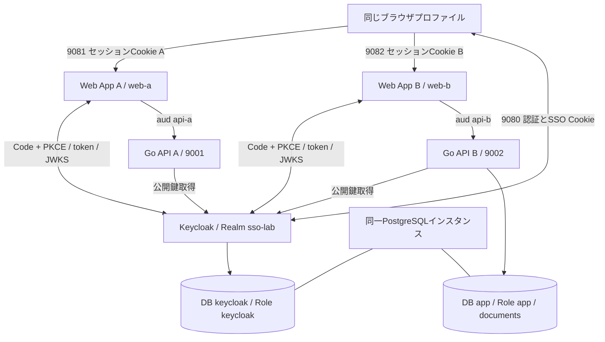
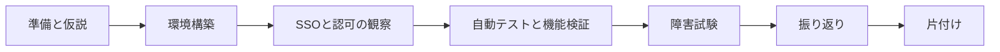

# Keycloak × Go：共有認証基盤とSSOを検証するハンズオン

## Overview

- **目的**：複数WebアプリでKeycloakを共有すると、何が共通化され、どこに依存と業務責任が残るかを実装で確認する
- **進め方**：操作手順の暗記ではなく、目的 → 仮説 → 構築 → 検証 → 観察 → 結論の順で進める
- **成果物**：Web App A/B、Go API A/B、Keycloak、PostgreSQLの6サービス。パスワードを自作Go APIが照合するコードは持たない
- **学習要素**：JWT、RBAC、所有者認可、Middleware、context.Context、database/sql、httptest
- **必要環境**：Docker（Compose v2以降）、Python 3.10以降、ブラウザ、curl。詳細は[Chapter 01](./docs/01-preparation.md#前提条件)
- **所要時間**：実測値として提示しない。初回のイメージ取得時間は回線とPCによって変わる

### 仮説

| 観点 | 仮説 |
| --- | --- |
| SSO | 同じRealmのSSOセッションによって、App Bではパスワード入力を省略できる |
| トークン境界 | App AのトークンをAPI Bへ送れば拒否される |
| 認可 | 認証は共通化できても、APIとデータの認可は各アプリに残る |
| 可用性 | IdP停止はログインと更新を止めるが、公開鍵をキャッシュしたAPIの有効JWT検証は継続できる |

## Architecture

「別APIへ同じトークン」ボタンの検証用に、web-aはapi-bへ、web-bはapi-aへも呼び出す経路を持つ。

## Hands-on Flow

## Chapters

| 章 | 達成すること | Step |
| --- | --- | --- |
| [Chapter 01: 準備と仮説](./docs/01-preparation.md) | 構成と責任を把握し、観察表を用意する | 1 |
| [Chapter 02: 環境構築](./docs/02-setup.md) | 秘密情報とRealmを生成し、6サービスを起動する | 2〜3 |
| [Chapter 03: SSOと認可の観察](./docs/03-sso.md) | SSOとトークン分離を観察し、文書データを用意する | 4〜5 |
| [Chapter 04: 自動テストと機能検証](./docs/04-verification.md) | テスト、拒否系、ログアウトを確認する | 6 |
| [Chapter 05: 障害試験](./docs/05-failure.md) | IdP停止と鍵ローテーションの影響範囲を観察する | 7〜8 |
| [Chapter 06: 振り返り](./docs/06-retrospective.md) | 観察結果を説明し、設計判断と結論をまとめる | - |
| [Chapter 07: 片付けと次の実験](./docs/07-cleanup.md) | リソースを削除し、費用と次の実験を確認する | 9 |
| [検証記録](./docs/validation.md) | 実行済みの検証と未実施事項を確認する | - |

## ソースコード

実装は[keycloak-go-sso/](./keycloak-go-sso/)にある。章の中のコマンドは、特に断りがなければこのディレクトリで実行する。各ファイルの役割は[Chapter 01](./docs/01-preparation.md#リポジトリ構成)を参照。

> **ローカル学習専用**：HTTP、Secure=falseのCookie、`start-dev`、Realm `sslRequired=none`、トークンのダウンロード機能は教材のための構成であり、本番にそのまま使わない。
