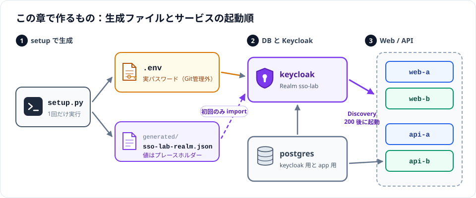
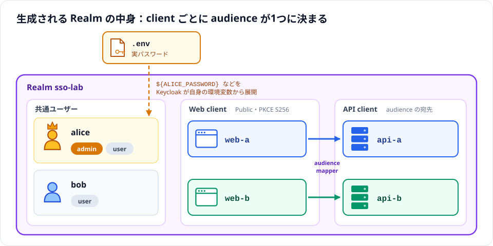
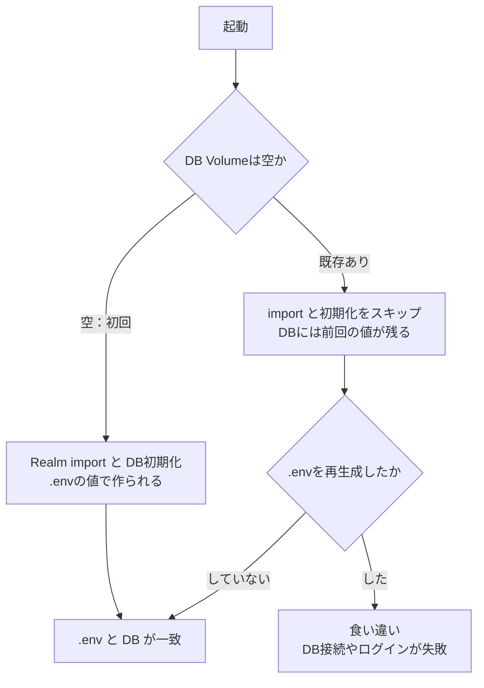
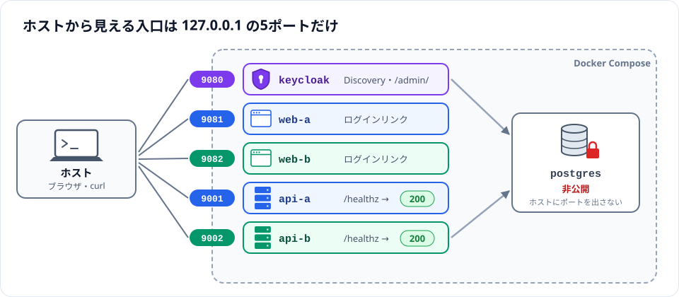
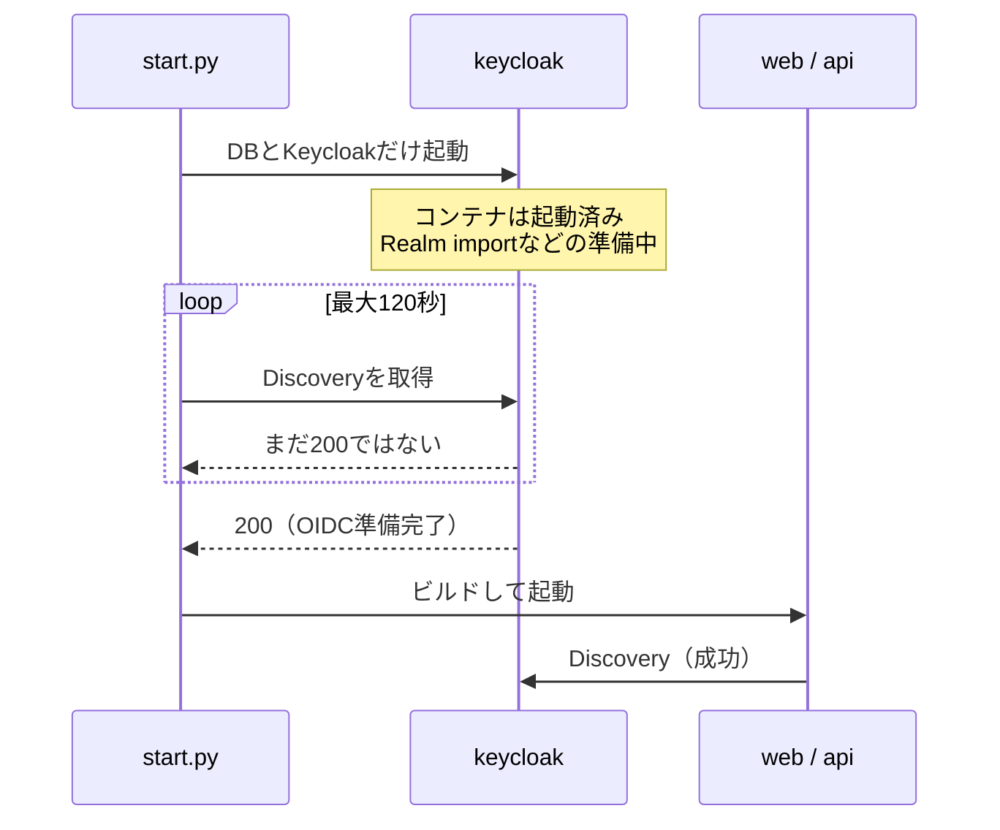

# Chapter 02: 環境構築

## この章の目的

パスワードをハードコードせずに秘密情報とRealmを生成し、共通IdPと独立したアプリを起動する。

## 現在地

準備と仮説 → **環境構築** → SSOと認可の観察 → 自動テストと機能検証 → 障害試験 → 振り返り → 片付け

## 完了条件

- [ ] `docker compose config --quiet` が終了コード0で終わる
- [ ] 6サービスが起動し、API A/Bの `/healthz` が200を返す
- [ ] Discoveryのissuerが `http://127.0.0.1:9080/realms/sso-lab` である
- [ ] App A / App Bにログインリンクが表示される

## この章で作るもの



PostgreSQLにkeycloak/app DBを作成し、それぞれ別Roleを使用する。Go API AはDBへ接続しない。API Bだけがapp DBへ接続する。

## Step 2. 秘密情報とRealmを生成する

### やること

`.env`とRealm import設定を生成する。使用するのは [scripts/setup.py](../keycloak-go-sso/scripts/setup.py)。

### 実行

```bash
cd keycloak-go-sso/
python3 scripts/setup.py
docker compose config --quiet
```

### 期待結果

- Compose設定検証が終了コード0
- 生成JSONに実パスワードがない
- 生成JSONに client web-a/web-b、audience api-a/api-b、PKCE S256、admin/user、alice/bob の定義がある
- scopeMappingsで必要なRealm rolesだけを許可している。標準のaudience resolveに依存しない専用mapperでAPIのaudienceを追加している

生成されるRealmの中身は次のとおり。clientごとにaudienceが1つに決まる点を、Chapter 03で確かめる。



### 注意事項

- `.env.example`は変数名の仕様。空値のまま起動せず、setupで各実行環境にランダム値を作る
- alice/bobのパスワードと管理者パスワードはローカル.envで確認する。画面共有・チャット・Gitへ貼らない
- 生成済み.envがある場合、setupは上書きを拒否する
- Realm JSONだけを再生成する場合は `python3 scripts/setup.py --realm-only`。DBにインポート済みのRealmは自動更新されない

### なぜ行うのか

KeycloakのRealm importとDB初期化は初回だけ実行される。既存Volumeを残したまま.envだけ再生成すると資格情報が食い違う。



setupが既存.envの上書きを拒否するのは、この食い違いを防ぐためである。

## Step 3. DBとKeycloak、Web/APIを起動する

### やること

[scripts/start.py](../keycloak-go-sso/scripts/start.py) で起動し、各サービスの状態を確認する。

### 実行

```bash
python3 scripts/start.py
docker compose ps
curl -fsS http://127.0.0.1:9080/realms/sso-lab/.well-known/openid-configuration
curl -i http://127.0.0.1:9001/healthz
curl -i http://127.0.0.1:9002/healthz
```

start.pyはKeycloakのDiscoveryが200になるまで最大120秒待ち、Web/APIをビルド・起動する。待機の上限を超えたら次を確認する。

```bash
docker compose logs --tail=80 keycloak postgres
```

### 期待結果

- 6サービスが起動し、両healthzが200
- issuerが `http://127.0.0.1:9080/realms/sso-lab`
- 管理画面は同ホストの `/admin/`、ユーザー名 `bootstrap-admin`。Realmのusers/clients/rolesを画面で確認できる
- App A（9081）とApp B（9082）にログインリンクが表示される

確認先をポートごとにまとめると次のとおり。公開先はすべて127.0.0.1で、PostgreSQLは公開しない。



### なぜ行うのか

Composeの「コンテナ起動」はOIDC準備完了と同義ではない。Webは起動時Discovery必須なので、いきなり全サービスを同時起動する手順を標準にしない。



同時に起動すると、Webが準備中のKeycloakへDiscoveryを要求して起動に失敗する場合がある。

---

次へ：[Chapter 03: SSOと認可の観察](./03-sso.md)
