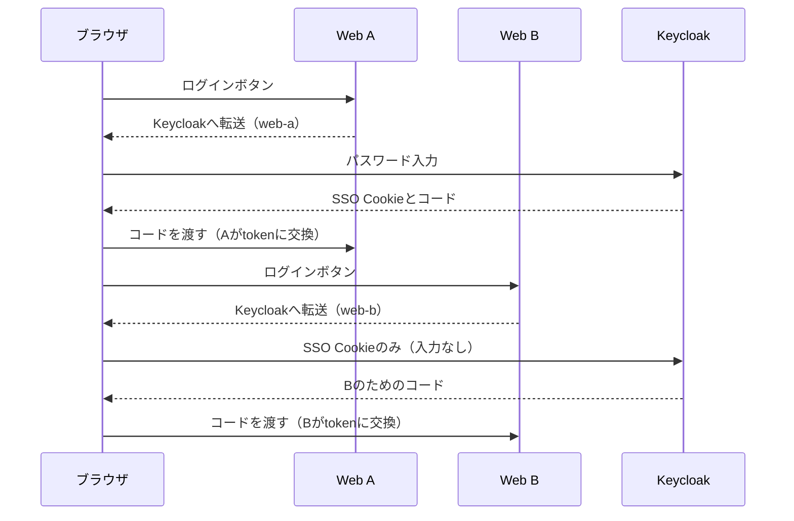

# Chapter 03: SSOと認可の観察

## この章の目的

App Aに一度ログインすれば、App Bではパスワードを入力せずにログインできること（SSO）をブラウザで確かめる。次に、ユーザーごとの文書データを用意し、自分の文書だけが見える状態を作る。

## 現在地

準備と仮説 → 環境構築 → **SSOと認可の観察** → 自動テストと機能検証 → 障害試験 → 振り返り → 片付け

## 完了条件

- [ ] App Bでパスワードフォームが出ずsubが表示され、両アプリのsubが同じである
- [ ] 「別APIへ同じトークン」が両アプリでHTTP 401になる
- [ ] 3つのtokenを保存し、seedが成功する
- [ ] 文書一覧がaliceはid=1だけ、bobはid=2だけになる

## 先に押さえる言葉

| 言葉 | この章での意味 |
|---|---|
| SSO | 1回のログインで複数のアプリを使えるしくみ。Keycloakがログイン済みであることをブラウザのCookieで覚えている |
| sub | Keycloakがユーザーごとに割り当てるID。画面の `sub:` に表示される |
| Access Token | APIを呼ぶための通行証。寿命は180秒 |
| audience | tokenの宛先となるAPI。宛先が違うtokenをAPIは受け付けない |
| 認可コード（code） | tokenと交換するための使い捨ての引換券 |
| state / nonce / PKCE（code_challenge） | ログイン要求のすり替えや引換券の横取りを防ぐ値。ログインのたびに作り直す |

## 観察する流れ

Bでパスワード入力がなくなるだけで、Bも自分用のコードを受け取ってtokenに交換している。



## Step 4. ログインとSSOを観察する

### やること

コマンドは `keycloak-go-sso/` で実行する。まず、ログインに使うパスワードを確認する。ユーザー名は `alice` と `bob`。出力を画面共有やチャット、Gitに貼らない。

```bash
grep -E '^(ALICE|BOB)_PASSWORD=' .env
```

続けて、同じブラウザの同じプロファイルで次の操作を行う。

1. `http://127.0.0.1:9081/` を開き、「Keycloakでログイン」を押してaliceで認証する
2. `http://127.0.0.1:9082/` を開き、同じように「Keycloakでログイン」を押す。Aの画面やtokenはコピーしない
3. 両アプリの `sub:` を見比べる
4. 両アプリで「別APIへ同じトークン」を押す

通信の中身も見ておく。開発者ツール（F12）のNetworkタブで「ログを保持」を有効にしてから、ログインをやり直す。`auth` で絞り込むと、Keycloakへの要求が見つかる。

| 確認する項目 | 見え方 |
|---|---|
| `client_id` | Aでは `web-a`、Bでは `web-b` |
| `state`、`nonce`、`code_challenge` | AとBで値が異なる |
| `callback` への `code` | AとBがそれぞれ別のコードを受け取る |

コードやtokenが含まれるので、HAR（通信の記録ファイル）を外部に共有しない。

### 期待結果

- Bでパスワードフォームが出ず、subが表示される
- 両アプリのsubは同じ
- 「別APIへ同じトークン」は両アプリでHTTP 401

※ 未検証（Networkタブの目視確認）。Aの要求に上記のパラメータが含まれることは、プログラムからの通信で確認した。

### なぜ行うのか

同じユーザーでも、tokenはアプリごとに別物であることを確かめるため。ロールは共通だが、Access Tokenのaudienceが異なるので、もう一方のAPIは401で拒否する。

SSOで省略されるのはKeycloakでのパスワード入力だけで、Bの認可フローは省略されない。Bも固有の認可コードとPKCE verifierでtokenを取得している。比較のため、毎回の再認証を求める `prompt=login` や `max_age=0` は付けていない。

## Step 5. API呼び出しと文書データを用意する

### やること

初期状態のapp DBには文書がなく、一覧は空になる。そこで、aliceとbobのsubを所有者とする文書を登録する。

まず、ログインとAPI呼び出しを済ませる。

1. aliceのまま、A/Bで「API /me」「API /admin」を押す。すべてHTTP 200になる
2. 別のブラウザプロファイルを開き、bobでA、Bの順にログインする

次にtokenを保存する。寿命が180秒なので、ここから下はseedまで続けて行う。各画面で「トークン更新」を押してから「学習用Access Tokenダウンロード」を押す。ブラウザの保存名は別のユーザーでも同じなので、1つ保存するたびに名前を変える。

| ユーザー | アプリ | ブラウザの保存名 | 変更後の名前 |
|---|---|---|---|
| alice | App A | `web-a.token` | `generated/alice-a.token` |
| alice | App B | `web-b.token` | `generated/alice-b.token` |
| bob | App B | `web-b.token` | `generated/bob-b.token` |

### 実行

例はWSLからWindows側のダウンロード先を指定している。パスはブラウザの設定に合わせる。保存のたびに、対応する行を実行する。

```bash
mv "/mnt/c/Users/<ユーザー名>/Downloads/web-a.token" generated/alice-a.token
mv "/mnt/c/Users/<ユーザー名>/Downloads/web-b.token" generated/alice-b.token
mv "/mnt/c/Users/<ユーザー名>/Downloads/web-b.token" generated/bob-b.token
```

名前を変える前に次を保存すると、ブラウザが `web-b (1).token` のような別名を付ける場合がある。

3つそろったらseedを実行する。

```bash
chmod 600 generated/*.token
python3 scripts/seed.py generated/alice-b.token generated/bob-b.token
```

`HTTP Error 401: Unauthorized` で止まったら、tokenの期限切れが考えられる。「トークン更新」を押さずにダウンロードし直しても同じtokenが返るので、必ず更新してから保存し直す。

seedは既存の文書をすべて消して登録し直す。教材専用の操作である。

### 期待結果

seedの最後に `Seeded document 1=Alice, document 2=Bob; previous documents replaced.` と表示される。

その後、App Bの「API /documents (B)」と「文書ID取得 (B)」で確認する。文書IDの欄は書き換えられる。

| ユーザー（App B） | 文書一覧 | id=1 | id=2 |
|---|---|---|---|
| alice | id=1だけ | 200 | 200（adminの例外） |
| bob | id=2だけ | 404 | 200 |

adminでも一覧は本人の文書に限られ、他者の文書を取得できるのは個別取得だけである。bobには、文書の存在を伝えないよう404を返す。

※ 未検証（この手順を手で行った場合に180秒以内に収まるか）。

### なぜ行うのか

ユーザー名は変更できるので、文書の所有者にはRealm内で変わらないsubを使う。

<details>
<summary>補足：seed.pyが行う処理</summary>

seedはtokenをAPI Bの `/api/me` へ送り、署名とclaimsを検証した結果のsubを使う。検証前のJWTをdecodeしただけの値は投入しない。SQLへはpsql変数のリテラル引用で渡す。id=1をalice、id=2をbobの文書として登録する。

</details>

---

次へ：[Chapter 04: 自動テストと機能検証](./04-verification.md)
