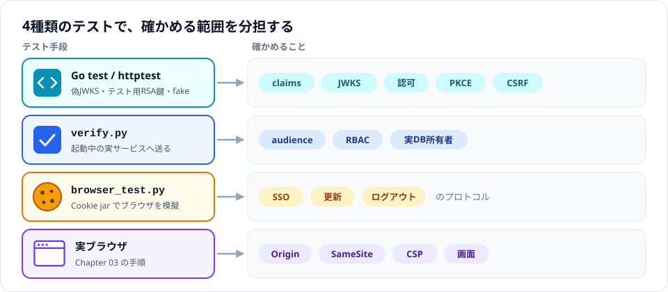
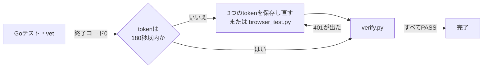
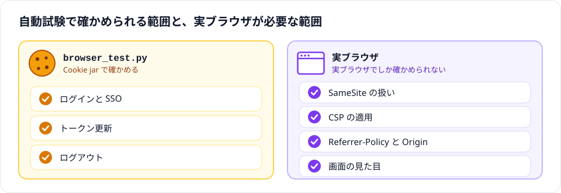

# Chapter 04: 自動テストと機能検証

## この章の目的

署名検証とclaim検証、アプリ認可、実サービス連携を自動テストで確認する。続けて、拒否系とログアウトの挙動を実サービスで確認する。

## 現在地

準備と仮説 → 環境構築 → SSOと認可の観察 → **自動テストと機能検証** → 障害試験 → 振り返り → 片付け

## 完了条件

- [ ] Goテストとvetが終了コード0で終わる
- [ ] `verify.py` が各期待HTTPコードをPASSで表示する
- [ ] 機能検証の表の結果を確認した
- [ ] ローカルログアウトとSSOログアウトの違いを確認した

## テストの範囲



本番コードの変更はない。テストごとに確認できる範囲が違うので、1つで他を代替しない。

## Step 6. 自動テストを実行する

### やること

Goテストの後に、実サービスへの結合試験を行う。

### 実行

Goテストと静的検査：

```bash
docker run --rm -v "$PWD:/src" -w /src golang:1.27.3-bookworm \
  sh -c 'go test -race ./... && go vet ./...'
```

> [!NOTE]
> Windows の Git Bash では `/src` がWindowsパスに書き換えられ、`the working directory '...' is invalid` で失敗する。次のようにパス変換を止めて実行する。
>
> ```bash
> MSYS_NO_PATHCONV=1 docker run --rm -v "$(pwd -W):/src" -w /src golang:1.27.3-bookworm \
>   sh -c 'go test -race ./... && go vet ./...'
> ```

結合試験は、Chapter 03で保存したtokenが180秒以内のものである必要がある。Goテストの間に期限が切れるので、**直前に3つのtokenを保存し直して**から実行する。

```bash
python3 scripts/verify.py generated/alice-a.token generated/alice-b.token generated/bob-b.token
```

実HTTPのSSO・更新・ログアウトも自動化できる。次のスクリプトは専用Cookie jarでログインし、3つのtokenをgeneratedに保存する。既存の同名tokenを置き換える。その後seed/verifyを実行する。tokenの再取得を手で行いたくない場合もこちらを使える。

```bash
python3 scripts/browser_test.py
python3 scripts/seed.py generated/alice-b.token generated/bob-b.token
python3 scripts/verify.py generated/alice-a.token generated/alice-b.token generated/bob-b.token
```

### 期待結果

- Goテストとvetが終了コード0
- Pythonは各期待HTTPコードをPASSで表示する
- 401が出たら、まずtokenを再取得して正常系を成立させる



### なぜ行うのか

PythonのCookie jarはプロトコル連携の自動試験用であり、実ブラウザのSameSite・CSP動作や見た目までは検証しない。127.0.0.1に限りSecure CookieをHTTPでも送るテスト用ポリシーで、ループバックを信頼するブラウザの挙動を模擬する。Originヘッダーも固定値で送るので、Referrer-Policyの影響を受けない。したがって、Chapter 03のブラウザ手順を省略しない。



ブラウザ向けのヘッダーの期待値は、Goの `TestBrowserPolicyHeaders` で固定している（理由は[Chapter 06](./06-retrospective.md#設計判断)）。

## 機能検証

正常系（aliceのme/admin、bobのme・本人文書）を先に確認してから拒否系を実行する。

| 対象 | API呼び出し | 期待結果 |
|---|---|---|
| API A | alice A tokenでGET /api/me、/api/admin | 200 |
| API A | bobでApp Aの「API /admin」ボタン | 403 |
| API B | alice B / bob B tokenでGET /api/me | 200 |
| API B | bob B tokenでGET /api/documents | 200、id=2のみ |
| API B | bob B tokenでGET /api/documents/1 | 404（存在漏えい抑制） |
| API B | alice B tokenでGET /api/documents/2 | 200（admin例外） |
| API B | 任意の正常tokenで存在しないID | 404 |
| API A/B | tokenなし | 401 + WWW-Authenticate: Bearer |
| API B | App A tokenでGET /api/me | 401（audience） |
| API A | App B tokenでGET /api/me | 401（audience） |
| API B | bob tokenで不正なID文字列 | 400、SQLとして実行されない |

curlで確認する場合の例：

```bash
curl -i -H "Authorization: Bearer $(cat generated/alice-a.token)" http://127.0.0.1:9001/api/admin
curl -i -H "Authorization: Bearer $(cat generated/alice-a.token)" http://127.0.0.1:9002/api/me
curl -i -H "Authorization: Bearer $(cat generated/bob-b.token)" http://127.0.0.1:9002/api/documents/1
curl -i -H "Authorization: Bearer $(cat generated/bob-b.token)" 'http://127.0.0.1:9002/api/documents/1%27OR%271%27%3D%271'
```

期待順序は200、401、404、400。秘密が引数として一時的にプロセス一覧へ現れる可能性があるため、ローカル学習用。シェルのset -xは無効にする。

### JWTの検証範囲

署名・issuer・audience・exp・nbf・typ・アルゴリズムはGoテストで個別に検証する。署名済みJWTの対象claimだけを変更して再署名し、正しいclaimの200を基準に401を確認する。単にpayloadを編集しただけでは署名失敗になるため「issuer検証を証明した」とは扱わない。

ID TokenはWebのログイン用として検証し、APIではAPI向けaudienceとKeycloak payload `typ=Bearer` の両方を要求して拒否する。JWTヘッダーtypとpayload typは別物。

## ログアウトの検証

| 操作 | App A | App B | IdPセッション |
|---|---|---|---|
| Aの「このアプリだけログアウト」 | セッション削除。再ログインはパスワード省略 | 継続 | 継続 |
| Aの「Keycloak SSOログアウト」 | セッション削除後、RP-Initiated Logoutへ遷移 | ローカルセッションは残る | 失効 |

SSOログアウトの後、Bは次のようになる。

- ローカルセッションは自動削除されない（本例はBack-Channel Logout未実装）
- 既存JWTは期限内ならAPIで通り得る
- トークン更新はIdPセッション失効で400になる
- Bをローカルログアウトしてログインするとパスワードが必要になる

## 共通ユーザー管理の追加観察

1. 管理画面でbobを無効化する
2. bobのA/Bローカルセッションを削除して再ログインする。どちらも新規ログインできない
3. 既存JWTの即時失効を期待しない
4. 検証後はbobを有効に戻す

Realmのロール変更も新規発行tokenから反映される。

※ 未検証（管理画面での操作とロール変更）。無効化そのものは管理CLIで実施し、新規ログイン拒否と既存JWTの200を確認した。

---

次へ：[Chapter 05: 障害試験](./05-failure.md)
