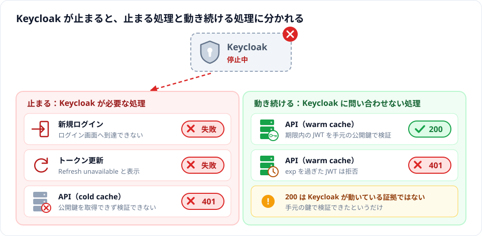
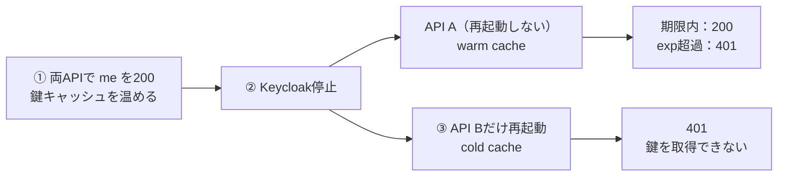
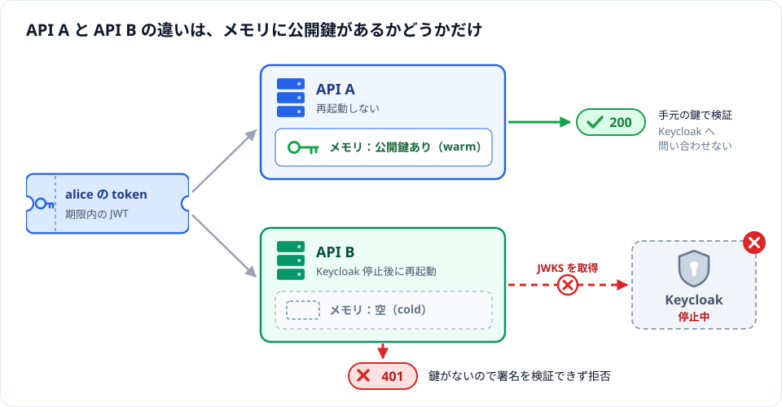
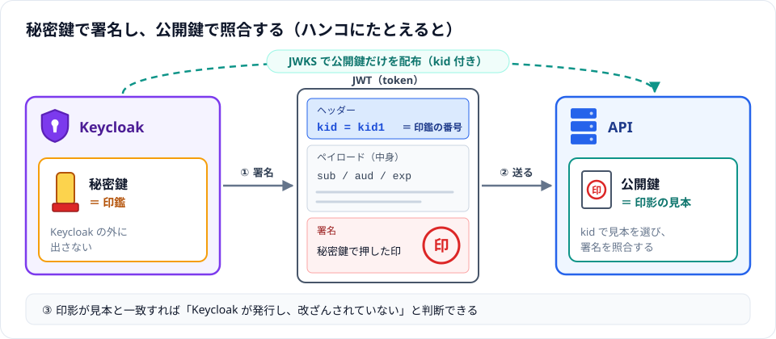
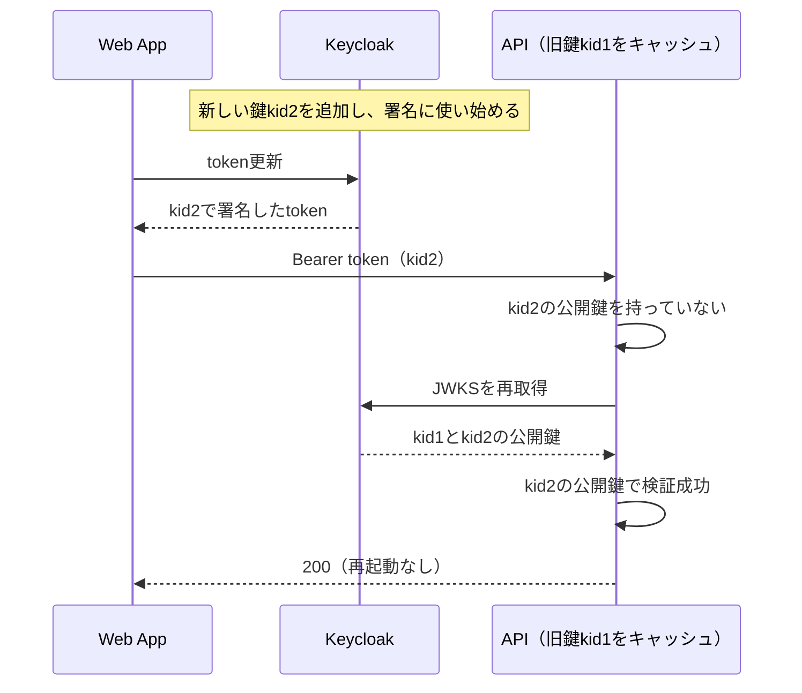
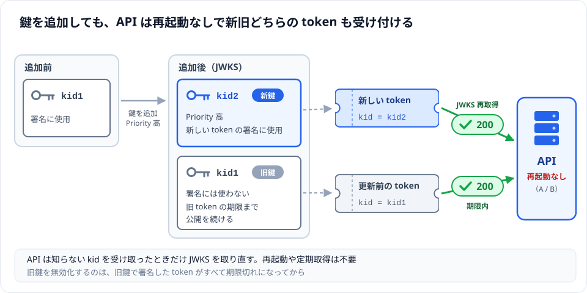
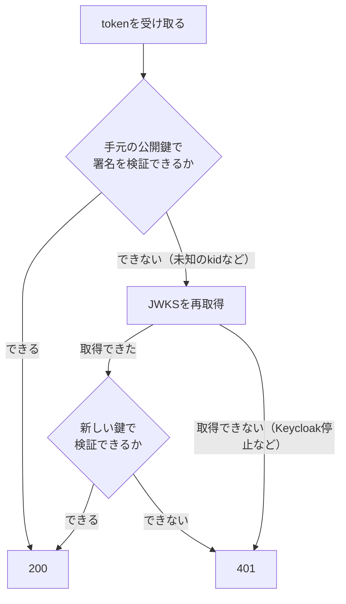

# Chapter 05: 障害試験

## この章の目的

ログイン・更新・オフラインJWT検証の障害境界を確認する。また、既知鍵のキャッシュと未知kidによる再取得を観察する。

## 現在地

準備と仮説 → 環境構築 → SSOと認可の観察 → 自動テストと機能検証 → **障害試験** → 振り返り → 片付け

## 完了条件

- [ ] IdP停止中の新規ログイン、更新、warm cache、cold cacheの結果を区別して説明できる
- [ ] Keycloakを復旧し、API Bが200へ戻ることを確認した
- [ ] 鍵ローテーション後の新しいkidのtokenが、API再起動なしで200になる

## 何が止まり、何が動くか



## Step 7. Keycloak停止と鍵キャッシュを分けて観察する

### やること

Keycloakだけ停止する。DB、Web、APIは動作を継続する。

A/Bを再ログインまたは更新して、直前発行のtokenを保存する。A/Bのmeを1回ずつ200にし、APIの鍵キャッシュを温める。ログアウト試験後の古いtokenを使い回さない。

### 実行

```bash
curl -fsS -H "Authorization: Bearer $(cat generated/alice-a.token)" http://127.0.0.1:9001/api/me
curl -fsS -H "Authorization: Bearer $(cat generated/alice-b.token)" http://127.0.0.1:9002/api/me
docker compose stop keycloak
curl -i -H "Authorization: Bearer $(cat generated/alice-a.token)" http://127.0.0.1:9001/api/me
curl -i -H "Authorization: Bearer $(cat generated/alice-b.token)" http://127.0.0.1:9002/api/me
```

続けてブラウザで2点を確認する。

- Webの「トークン更新」は即時にtoken endpointへアクセスし、ネットワーク/IdP利用不可を表示する。自動更新は意図的に実装していない
- 新しいブラウザプロファイルでAのログインをクリックし、Keycloakへ到達できないことを確認する。既存Webセッションの画面表示と新規ログイン成功を混同しない

次にAPI Bだけ再起動してcold cacheを作る。

```bash
docker compose restart api-b
curl -i -H "Authorization: Bearer $(cat generated/alice-b.token)" http://127.0.0.1:9002/api/me
```

### 期待結果

| 操作 | 期待結果 |
|---|---|
| 停止直後、warm cacheで有効JWT | API A/Bとも200 |
| 新規ログイン | Keycloakに接続できず失敗 |
| Webの更新ボタン | Refresh unavailableと表示 |
| API B再起動後のcold cache | 401（数秒以内の取得失敗） |
| 再起動しないAPI A | tokenの期限内200 |
| exp超過 | warm cacheでも401 |
| /healthz | Aは200、BはDBが動けば200。IdP readinessは表さない |

API A と API B の違いは、鍵キャッシュの状態だけである。



### 判定の注意

- APIへのcurlは再起動完了後に実行する。瞬間的なconnection refusedはcold-cache判定ではない
- 180秒の期限と起動時間を記録してから比較する
- 期限切れは元のexpを過ぎてから確認し、payloadを編集しない

### 復旧

```bash
docker compose start keycloak
python3 scripts/start.py
```

復旧後、既存IdPセッションが残っていれば更新可能。セッション期限を超えた場合は再ログインする。API Bも有効JWTを送れば鍵を取得し200へ戻る。

### 自動で行う場合

```bash
python3 scripts/failure_test.py            # 新規ログイン、更新失敗、warm/cold cacheを確認し、finallyでKeycloakを再起動する
python3 scripts/failure_test.py --expiry   # 実際の180秒の期限切れも待つ
```

教材サービスを停止・再起動するので、他の試験と同時実行しない。中断で復旧しなかった場合はstart.pyを実行する。

### なぜ行うのか

api-bの再起動でメモリ内JWKSキャッシュが消える。API Bの初回認証はJWKS取得が必要となり失敗する。API Aは再起動せず比較する。



warm cacheの200は「Keycloakが動いている」証拠ではない。手元の鍵で検証できたというだけである。

## Step 8. 鍵ローテーション

### 背景：鍵ローテーションとは

Keycloakが発行するJWTには、改ざんされていないことを示す署名が付いている。仕組みは次のとおり。

- Keycloakは**秘密鍵**でJWTに署名する。秘密鍵はKeycloakの外に出さない
- APIは**公開鍵**で署名を検証する。公開鍵はKeycloakのJWKSエンドポイントから取得する
- Keycloakは複数の鍵を持てるので、JWTのヘッダーには署名に使った鍵のID（`kid`）が入っている。APIは`kid`を見て、どの公開鍵で検証するかを選ぶ

ハンコにたとえると、秘密鍵は印鑑、公開鍵は印影の見本、`kid`は「どの印鑑で押したか」の番号にあたる。



**鍵ローテーション**は、署名に使う鍵を新しいものへ切り替える運用である。次のような理由で行う。

- 長く同じ鍵を使い続けるほど、漏えいしたときの被害期間が長くなる
- 秘密鍵の漏えいが疑われたら、すぐに鍵を差し替える必要がある
- セキュリティ基準や社内ルールで、定期的な交換を求められることがある

### このStepで確かめたいこと

Step 7で見たとおり、APIは公開鍵をメモリにキャッシュし、Keycloakへ毎回問い合わせずに検証している。そうなると、次の疑問が出てくる。

> Keycloak側で鍵を切り替えたら、APIは古い公開鍵しか持っていないので、新しい鍵で署名されたtokenを拒否してしまうのではないか？
> そのたびにAPIを再起動しないといけないのか？

もし再起動が必要なら、鍵ローテーションのたびにKeycloakを共有する全APIを再起動しなければならない。共有認証基盤としては運用が重くなる。

このStepでは、**APIを再起動しなくても、新しい`kid`のtokenを受け付けられること**を確かめる。合わせて、切り替え前に発行された古いtokenも期限内は使い続けられることを確認する。



### やること

Realmに優先順位の高い署名鍵を追加する。

1. 管理画面のRealm settings → Keys → Providers → rsa-generatedを追加する
2. Algorithm RS256、Enabled/ActiveをON、Priorityを既存のRSA providerより高く設定する
3. A/Bでtoken更新し、新しいkidになることをローカルで確認する（decodeは観察用であり検証ではない）
4. API再起動なしでmeを呼ぶ

### 期待結果

新鍵の正常tokenが200。旧鍵は旧tokenの期限が切れるまで公開鍵を残す。未知鍵取得先が停止したケースはGoの `TestJWTAndJWKS` でも自動検証する。



※ 未検証（管理画面での操作）。同じ鍵の追加を管理CLIで実施し、新しいkidのtokenがAPI再起動なしで200になることを確認した。

### なぜ行うのか

鍵ローテーションに再起動なしで追従できるのは、APIが使うgo-oidcのRemoteKeySetの動きによる。RemoteKeySetはプロセス内の公開鍵を利用し、署名を検証できない場合にだけJWKSを再取得する。独自の固定TTL、永続キャッシュ、定期取得は追加していない。

この動きから、Step 7とStep 8の結果は次のようにつながる。

| 状況 | 手元の鍵 | 結果 |
| --- | --- | --- |
| Keycloak停止中、既知の`kid`（Step 7 warm cache） | ある | 再取得不要なので200 |
| Keycloak停止中、鍵キャッシュなし（Step 7 cold cache） | ない | 再取得できず401 |
| Keycloak稼働中、新しい`kid`（Step 8） | ない | 再取得して200 |
| Keycloak停止中、新しい`kid` | ない | 再取得できず401（`TestJWTAndJWKS`で確認） |

最後の行は、取得できない未知の鍵を「たぶん大丈夫」として通さないことを示す。署名を確認できないtokenは拒否するのが安全側の判断である。

旧鍵の公開を旧tokenの期限まで残すのも同じ理由である。旧鍵をすぐ消すと、切り替え直前に発行されたtokenが期限内でも検証できず、利用者には突然のエラーに見える。本番で旧鍵を無効化するのは、旧鍵で署名したtokenがすべて期限切れになってからにする。



---

次へ：[Chapter 06: 振り返り](./06-retrospective.md)
