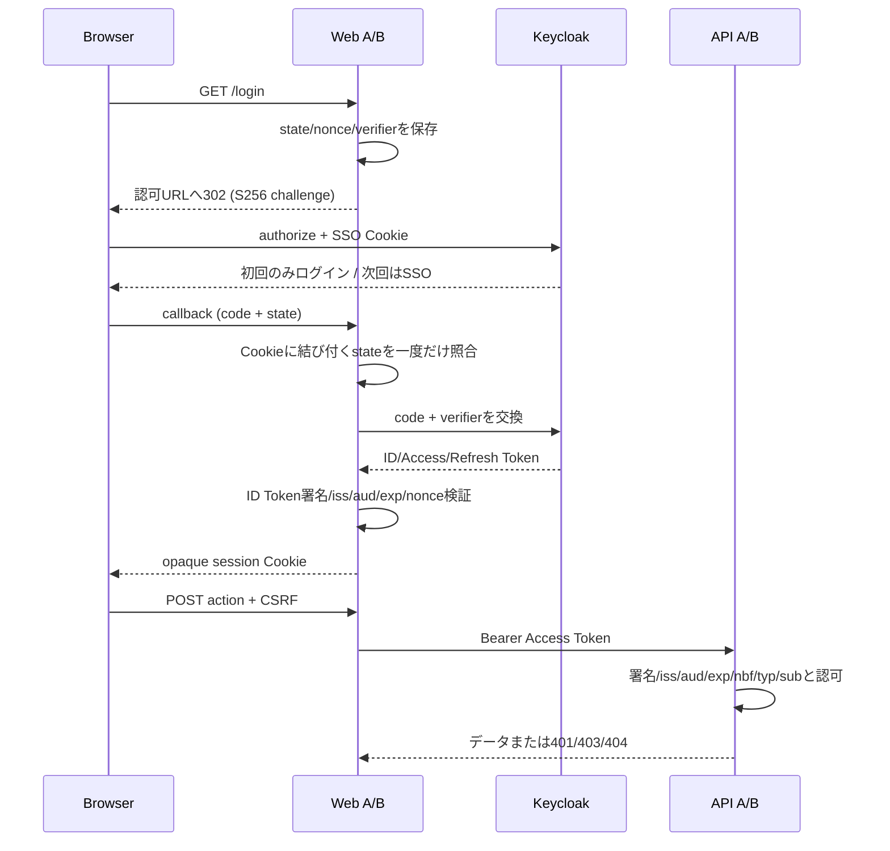

# Chapter 06: 振り返り

## この章の目的

記入した観察表と照合し、なぜその結果になったのかを説明する。設計判断とトレードオフを確認し、検証結果にもとづく結論を書く。

## 現在地

準備と仮説 → 環境構築 → SSOと認可の観察 → 自動テストと機能検証 → 障害試験 → **振り返り** → 片付け

## 完了条件

- [ ] 「学んだこと」の各項目を自分の観察で説明できる
- [ ] 「結論」の3つの問いに、検証結果をもとに答えを書いた

## 何が起きたか

**SSO**：SSO成功時、Bは新しい認可要求を行ったが、KeycloakのCookieで本人確認済みと判断された。A/Bそれぞれのコード交換とtoken発行は省略されていない。ユーザーのsubは共通でもaudienceとWebセッションは別である。

**認可**：bobのJWTが正常でもadmin操作は403になる。他者文書はSQLの所有者条件で抽出されず404になる。Keycloakはdocumentsの所有者を知らない。認証成功と業務上のアクセス許可は別の判断である。

**可用性**：IdP停止中の200はKeycloakへ問い合わせず署名を検証した結果であり、IdPが健全である証拠ではない。cold cacheの401はユーザー資格情報の不正だけでなく、検証に必要な鍵を取得できない場合も含む。本教材ではfail closedを優先して同じ応答にまとめる。本番は内部メトリクスで鍵取得障害と不正JWTを分類する。

## なぜ動くのか



**Web（[web.go](../keycloak-go-sso/internal/lab/web.go)）**：PKCEは盗まれた認可コードだけで交換されることを防ぐ。stateはブラウザに結び付いた認可応答の取り違えを防ぎ、nonceは初回ID Tokenを要求と結び付ける。stateとverifierは3分で失効し、一回使用で削除する。コールバック成功後は新しいランダムセッションIDを発行する。更新ID Tokenは署名/iss/aud/expとsub一致を検証し、新規nonceは要求しない。更新応答にnonceが含まれる場合は初回の値との一致も検証する。

**API（[api.go](../keycloak-go-sso/internal/lab/api.go)）**：go-oidcの検証基盤をAccess Tokenに適用する。名称がIDTokenVerifierでもAPIの期待audienceに固定し、RS256のみ許可する。iss/aud/expはライブラリ、nbf・空sub・payload typは追加処理。トークンをdecodeしただけのロールは使わない。検証後のIdentityを型付きcontextキーで渡す。

**DB**：API BのSQLは一覧でowner_sub、個別でid AND (owner_sub OR admin)を条件にする。

```sql
SELECT id,owner_sub,title,body FROM documents WHERE owner_sub=$1 ORDER BY id
SELECT id,owner_sub,title,body FROM documents WHERE id=$1 AND (owner_sub=$2 OR $3)
```

Repository interfaceはhttptestで認可条件の受け渡しを検証するための最小抽象化。実DBの行分離はseed/verifyによる結合試験で確認する。

## 設計判断

| 判断 | 理由・制約 |
|---|---|
| 1 Realm / 2 Web clients / 2 API audiences | SSO範囲を共通化し、API向けtokenは分離 |
| Realm roles admin/user | 共通権限の最小例。API独自権限が増えたらclient rolesを検討 |
| API Bのadminは他者の個別文書のみ可 | 一覧の過剰公開を避け、例外を明示 |
| 所有者と不存在はともに404 | IDOR/BOLAの存在情報を減らす |
| 1 PostgreSQL / 2 DB / 2 Role | リソースを抑えつつ資格情報とテーブルを分離。物理障害は共有 |
| サーバー側token保管 | JS/localStorageへtokenを持たせず、CORS構成も不要 |
| 手動refreshボタン | 障害時の更新失敗を隠さず観察する |
| APIは既知JWKS URLを固定 | IdP停止中にcold cacheのAPIを起動して検証できる |
| メモリセッション | 外部セッションストアを省略。再起動でログアウト、複数レプリカ非対応 |
| 同一イメージのweb/apiモード | ビルドを簡単にし、起動プロセスと設定は独立させる |
| `Referrer-Policy: same-origin` | `no-referrer` だとブラウザがフォームPOSTで `Origin: null` を送り、Origin照合で全操作が403になる |
| CSP `form-action 'self' http://127.0.0.1:9080` | Chrome/EdgeはフォームPOST後のリダイレクト先にもform-actionを適用する。Keycloakを許可しないとSSOログアウトがブロックされる |

### CookieとCSRF

CookieはHttpOnly/SameSite=Lax、アプリ別名でセッションを分離する。ただしCookieはポート単位で分離されない。同一127.0.0.1上の別アプリもCookieを受け取り得る。完全な敵対アプリ隔離を表す構成ではなく、本番は独立ホスト名とTLS・Host-only Cookieを使う。

POSTはCSRF tokenとOriginの両方を照合し、GETに更新・ログアウト処理を置かない。Keycloak logoutへの遷移だけはOIDC仕様に従う。

### ログアウトの限界

SSOログアウトは他アプリのローカルセッション削除や発行済みJWT即時失効を保証しない。Back-Channel Logout、短いtoken寿命、必要に応じたintrospectionや業務側の失効管理を別途設計する。

## トレードオフ

以下は定性的な比較。工数・性能・費用の実測値として扱わない。「Goで個別認証」には成熟した認証ライブラリを使う場合も含み、手書き認証が同等の安全性を持つとは仮定しない。

| 観点 | Keycloak共有 | Goでアプリ別認証 |
|---|---|---|
| 開発工数 | OIDC統合と運用設計が必要。複数アプリで認証機能を再利用 | 小規模では導入が軽い場合があるが、認証機能・復旧導線がアプリ数分増える |
| 共通化 | ユーザー、認証ポリシーを中央管理 | 変更を各アプリへ展開、情報整合性が課題 |
| セキュリティ | 認証機能を集約して管理できる。設定・IdP権限の影響も集中 | アプリごとの実装・更新品質に依存。漏えい範囲は分離可能 |
| SSO | 同じRealmのIdPセッションを利用 | 追加の共通プロトコル・基盤が必要 |
| 運用負荷 | IdP/DB更新、監視、バックアップ、可用性設計が追加 | IdP自体は不要でも、各アプリの認証運用が残る |
| 障害影響 | 新規ログイン/更新が複数アプリで同時停止。JWT検証は条件付き継続 | 障害を局所化しやすいが、共通DB等があれば同時影響もある |
| 拡張性 | MFA、外部IdP、連携アプリ追加を集約しやすい | アプリ独自要件に合わせやすいが重複しやすい |

Keycloakを導入しても認可の設計、不正データ参照の防御、アプリの脆弱性対応は残る。共有基盤は「責任の消滅」ではなく「責任の移動と集約」である。

## 学んだこと

学習完了は以下を自分の観察で説明できることとする。

- SSOとAccess Token共有の違い、Bでもコード交換が必要な理由
- 共通ユーザーを使ってもAPIごとにaudienceを制限する理由
- 有効なJWTでも403/404になる理由と、業務DBでの所有者チェック
- IdP停止時の新規ログイン、更新、warm/cold cacheの違い
- ログアウト・ユーザー無効化・ロール変更が発行済みJWTに即時反映されない理由
- 認証外部化で減る実装と、増える運用・障害依存

## 結論

検証結果をもとに、次の3つを記述する。

1. 2つのWebアプリは認証とSSOを共有できたか
2. tokenのAPI境界と業務認可は維持できたか
3. IdP停止で何が止まったか

期待と異なる結果があれば、Cookie領域・issuer・audience・token期限・鍵キャッシュ状態・既存Volumeを確認する。Keycloakの採用判断はアプリ数だけでなく、共通認証要件と運用体制で決める。

実行済みの検証と未実施事項は[検証記録](./validation.md)にある。

---

次へ：[Chapter 07: 片付けと次の実験](./07-cleanup.md)
