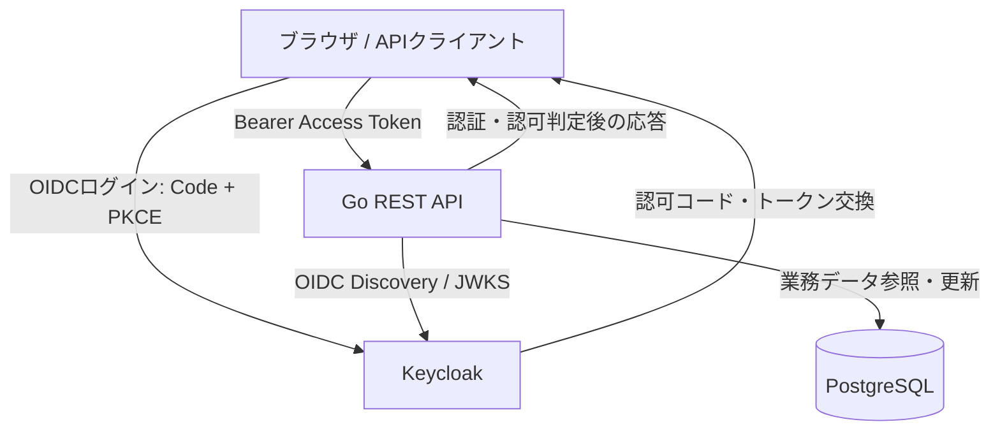

# Keycloak × Go 認証・認可ハンズオン

## 1. 目的

Keycloakを外部認証基盤（IdP）として利用し、Go製REST APIと連携する。認証（本人確認）と認可（操作・データへのアクセス可否）の責任分界を実装と攻撃系テストで理解する。

### 到達目標
- KeycloakのRealm、Client、User、Roleの役割を説明できる。
- OIDC Authorization Code Flow + PKCEでログインできる。
- Go APIでアクセストークンの署名、issuer、audience、有効期限を検証できる。
- RBACと所有者ベースの認可を実装し、拒否系テストを通せる。
- Docker Composeで環境を再現できる。

## 2. 技術スタック

| 領域 | 技術 | 用途 |
|---|---|---|
| バックエンド | Go（`net/http`） | REST API、認証Middleware、認可 |
| IdP | Keycloak | OIDC、ユーザー・ロール管理、JWT発行 |
| DB | PostgreSQL | 業務データ保存 |
| コンテナ | Docker Compose | 開発環境起動 |
| DBアクセス | Go `database/sql` + PostgreSQLドライバ | SQL操作 |
| JWT/OIDC | 信頼できるGoライブラリ | OIDC Discovery、JWKS取得、検証 |
| テスト | `testing`、`httptest` | API・認可の自動テスト |

## 3. 構成



**責任分界**：Keycloakは認証、ユーザー・ロール管理、トークン発行を担当。Go APIは受け取ったトークンを検証し、API権限とレコード所有権を判断する。Keycloakの導入だけではGo側の認可処理は不要にならない。

## 4. 推奨ディレクトリ

```text
keycloak-go-hands-on/
├── compose.yaml
├── .env.example
├── README.md
├── keycloak/
│   └── realm-export.json       # 必要に応じてRealm設定をエクスポート
├── db/
│   └── init.sql
└── api/
    ├── Dockerfile
    ├── go.mod
    ├── cmd/server/main.go
    ├── internal/auth/           # OIDC/JWT検証、Middleware
    ├── internal/handler/        # HTTPハンドラ
    ├── internal/authorization/  # ロール・所有者判定
    ├── internal/repository/     # DBアクセス
    └── internal/handler/handler_test.go
```

## 5. 開発環境の設定方針

- Docker ComposeでKeycloak、Go API、PostgreSQLを起動する。
- Keycloakの開発用起動モード `start-dev` はローカル検証限定とする。
- Keycloak管理画面は `127.0.0.1:8080` にバインドする。
- PostgreSQLは外部公開せずCompose内部ネットワークから接続する。
- Keycloakのバージョンは利用時に公式で確認し、パッチバージョンまで固定する。
- 管理者パスワード、DB認証情報、クライアントシークレットはGitにコミットしない。
- ブラウザからのissuer URLとコンテナ内部からの到達先の差異に注意し、トークンの`iss`とAPI検証設定を一致させる。署名検証のためにissuerチェックを無効化しない。

## 6. Keycloak設定

| 項目 | 値・方針 |
|---|---|
| Realm | `hands-on` |
| ブラウザ用Client | `hands-on-web`（Public Client） |
| ブラウザ認証 | Authorization Code Flow + PKCE（S256） |
| Redirect URI | ローカルで使用するコールバックURLを厳密に登録 |
| API対象Client | `django-api`ではなく`go-api` |
| Access Token audience | `go-api` を含むようAudience Mapper等を設定 |
| Realm Role | `admin`, `user` |
| テストユーザー | `alice`（admin）、`bob`（user） |

※ アクセストークンに含まれるロールの場所（例：`realm_access.roles`）を実際に確認する。`admin`ロールを付与しただけでAPIのaudienceが自動設定されるわけではない。

## 7. ハンズオンの実施ステップ

### STEP 1：Docker Compose環境構築
1. ComposeでKeycloak、PostgreSQL、Go APIを定義する。
2. `docker compose up -d --build` で起動する。
3. `docker compose ps` とログで正常起動を確認する。
4. Keycloak管理画面とGo APIのヘルスチェックにアクセスする。

**合格条件**：3サービスが起動し、APIがDBへ接続できる。

### STEP 2：Realm・Client・User・Roleの作成
1. Realm `hands-on` を作成。
2. Public Client `hands-on-web` にCode Flow + PKCEを設定。
3. API用のaudience `go-api` を設定。
4. `alice`、`bob`を作成し、ロールを割り当てる。
5. OIDC Discovery (`/.well-known/openid-configuration`) を確認する。

**合格条件**：Realm設定、ユーザー、ロール、OIDCエンドポイントを説明できる。

### STEP 3：OIDCログイン
1. ブラウザを認可エンドポイントへリダイレクトする。
2. `state`、`nonce`、PKCEの`code_verifier`/`code_challenge`を安全に扱う。
3. 認可コードをトークンエンドポイントで交換する。
4. ID TokenとAccess Tokenの用途の違いを確認する。
5. APIにはID TokenではなくAccess Tokenを送る。

**合格条件**：ログイン成功後、適切なaudienceを持つAccess Tokenを取得できる。

### STEP 4：GoでJWT検証Middlewareを実装
1. OIDC DiscoveryからJWKS URIを取得する。
2. JWKSの公開鍵を用いて署名を検証する（`alg`を無条件に信頼しない）。
3. `iss`、`aud`、`exp`、必要に応じて`nbf`を検証する。
4. `sub`やロールをリクエストの`context.Context`へ格納する。
5. 無効トークンは401で拒否する。

**合格条件**：正当なAccess Tokenのみ保護APIにアクセスできる。

### STEP 5：RBACを実装
1. `/api/admin/`をadmin限定にする。
2. ロールを検証済みAccess Tokenから取得する。
3. bobからのアクセスは403で拒否する。

**合格条件**：aliceは200、bobは403になる。

### STEP 6：PostgreSQLと所有者ベース認可
1. `documents(id, owner_sub, title, body)` テーブルを作る。
2. `owner_sub`にKeycloakのユーザー識別子`sub`を保存する。
3. 一覧は本人のレコードに絞り込む。
4. 個別取得は本人またはadminのみ許可する。
5. SQLはパラメータ化し、IDOR/BOLAを防止する。

**合格条件**：bobはaliceの文書を取得できない。

### STEP 7：テストと脅威検証
1. `go test ./...`でユニット・APIテストを実行する。
2. `httptest`で認証Middleware、RBAC、所有者判定をテストする。
3. トークン改ざん、期限切れ、issuer/audience不一致を検証する。
4. Keycloak停止時の動作とJWKSキャッシュの扱いを確認する。

**合格条件**：下記の拒否系ケースを満たす。

## 8. API仕様

| Method | Path | 認証 | 認可 | 期待結果 |
|---|---|---|---|---|
| GET | `/healthz` | 不要 | 不要 | 200 |
| GET | `/api/public/` | 不要 | 不要 | 200 |
| GET | `/api/me/` | 必要 | ログイン済み | 200 / 401 |
| GET | `/api/admin/` | 必要 | admin | 200 / 403 |
| GET | `/api/documents/` | 必要 | 自分の文書のみ一覧 | 200 |
| GET | `/api/documents/{id}/` | 必要 | 所有者またはadmin | 200 / 403または404 |

## 9. セキュリティテストケース

| ケース | 期待結果 |
|---|---|
| トークンなしで保護APIにアクセス | 401 |
| JWTペイロードを改ざん | 401 |
| 期限切れAccess Token | 401 |
| issuerが異なるAccess Token | 401 |
| audienceが`go-api`でないAccess Token | 401 |
| ID TokenをAPIのAccess Tokenとして送信 | 401（API向けaudienceを満たさない構成） |
| bobで`/api/admin/`にアクセス | 403 |
| bobでaliceの文書にアクセス | 403または404 |
| SQLインジェクションを試す | 不正SQLとして実行されない |
| Keycloak/JWKS取得先が一時停止 | 既存キャッシュの方針に従い安全に処理、未検証トークンを許可しない |

## 10. Go固有の学習項目

- `net/http`でのルーティングとHandler
- 認証Middlewareのチェーン
- `context.Context`による検証済みClaimsの受け渡し
- `database/sql`とPostgreSQLドライバ
- `interface`による認証・Repositoryのテスト容易性向上
- `testing`、`httptest`、テーブル駆動テスト
- エラーの分類：401（未認証・無効トークン）と403（認証済みだが権限不足）

## 11. 完了判定

- [ ] Composeで環境を再現できる
- [ ] Realm/Client/User/Roleの役割を説明できる
- [ ] Authorization Code + PKCEでログインできる
- [ ] Go APIがJWKSで署名・Claimsを検証できる
- [ ] admin/userのRBACが機能する
- [ ] 文書の所有者チェックが機能する
- [ ] セキュリティ拒否系テストが通る
- [ ] 認証と認可の責任分界を説明できる

## 12. 本番運用との差分

本ハンズオンは**ローカル学習用**。本番ではTLS、堅牢な管理者認証、MFA、秘密情報管理、Keycloak/DBのバックアップ、可用性、ログ監査、パッチ適用、リバースプロキシ・hostname設定、Cookie/CSRF保護、トークンの安全な保管・失効方針を別途設計する。ブラウザに長期トークンを安易に保存しない。

---

**成果物の範囲**：この文書はハンズオンの要件・設計・実施計画であり、実行可能なソースコード一式ではない。実装時にはSTEP 1から順に作成する。
